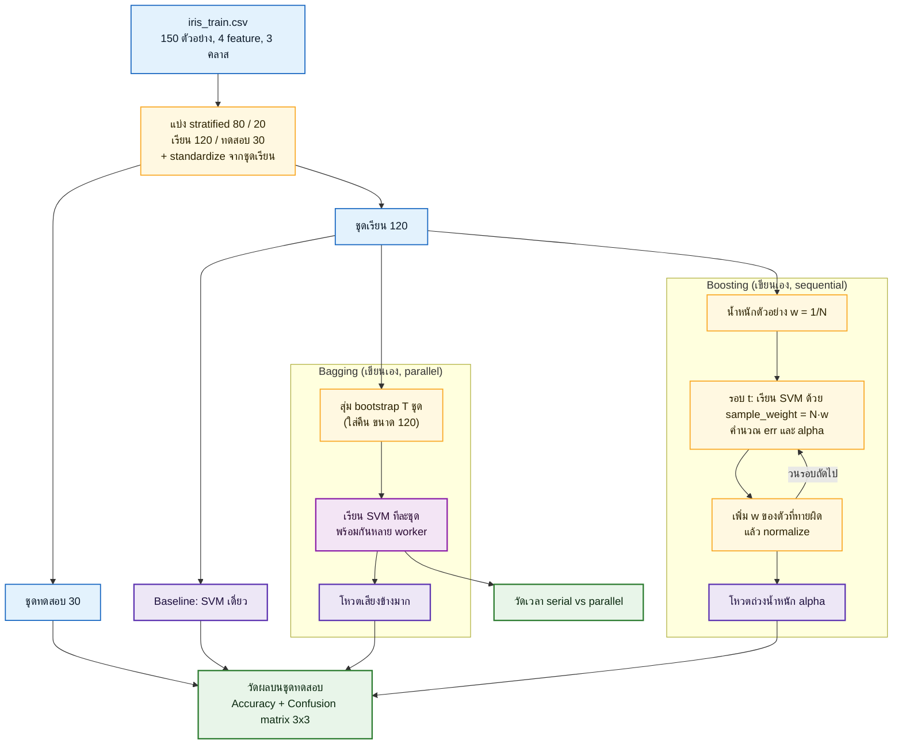
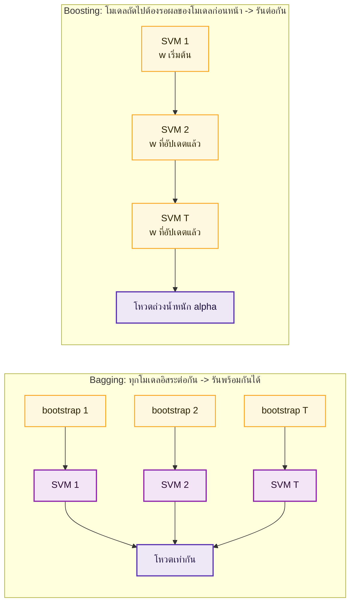

# Ensemble Method (Bagging + Boosting) ด้วย SVM บนชุดข้อมูล Iris

เอกสารโจทย์ ขอบเขต และแผนงาน (เขียนก่อนเริ่มลงมือทำ)
อัปเดตล่าสุด: 13 พ.ย. 2026 (ฉบับที่ 3: ใช้ SVM อย่างเดียว) | กำหนดทำ: **ให้เสร็จภายในวันนี้** | สถานะ: **ยังอยู่ในขั้นวางแผน ยังไม่เริ่มสร้างงานจริง**

---

## 1. ภาพรวมโจทย์

เขียน **Ensemble Method 2 แบบ** ด้วยตัวเอง แล้วเอาไปทดสอบกับชุดข้อมูล **Iris (150 ตัวอย่าง)** โดยใช้ **SVM เป็น classifier ตัวย่อยตัวเดียว (ไม่ผสมชนิดอื่น)**

| วิธี | รูปแบบการรัน | สิ่งที่ต้องทำเอง |
|---|---|---|
| **Bagging** | **Parallel computing** (รันหลายตัวพร้อมกัน) | สุ่ม bootstrap, เรียน SVM หลายตัวพร้อมกัน, โหวตผล |
| **Boosting** | **Sequential** (รันต่อกันทีละตัว) | ถ่วงน้ำหนักตัวอย่าง, เรียน SVM ทีละรอบ, รวมผลแบบถ่วงน้ำหนัก |

ข้อกำหนดสำคัญจากอาจารย์
- **Bagging และ Boosting ต้องเขียนเอง ไม่ใช้ library สำเร็จรูป** เพื่อฝึกใช้ Parallel Computing ใน Python
- **Classifier ตัวย่อย ใช้ library ได้** (อาจารย์ยกตัวอย่าง KNN, Logistic Regression, SVM, Decision Tree, Neural Network, Naive Bayes และบอกว่าผสมได้) งานนี้เลือกใช้ **SVM ตัวเดียว** ตามสไลด์ ซึ่งเป็นสิทธิ์ที่เลือกได้
- ใช้ library ของ Python ทำ Parallel Computing ได้เลย
- ต้องอัปโหลดงานส่ง (ตามที่อาจารย์เตือนท้ายคลิป) ไม่ต้องสนใจวันที่ 24 ตามที่ผู้ใช้สั่ง

### ข้อความโจทย์ตามที่ได้รับ (ถอดจากเสียงบรรยาย 2 ฉบับ)
- ทำ Ensemble Method 2 อย่าง: Bagging กับ Boosting
- ใช้ Dataset Iris มี 150 sample
- Bagging ต้องรันแบบ parallel computing ส่วน Boosting เป็น sequential รันปกติ
- Bagging / Boosting ต้องเขียนเอง ส่วน classifier ใช้ library ได้ ผสมกันอย่างไรก็ได้

### ข้อสังเกตเรื่องการถอดเสียง (ตีความเอง)
- "Backing / Blacking" = **Bagging**, "Digition Tree" = Decision Tree, "Base Theorem" = Bayes / Naive Bayes
- ชื่อ library parallel ของ Python ฟังไม่ชัด (อาจเป็น `multiprocessing` หรือ `joblib`) ในแผนนี้ใช้ `joblib` (ข้อ 4.1)
- ฉบับหนึ่งเขียนว่า "แทบไม่ต้องใช้ Library" อีกฉบับว่า "ห้ามใช้ library" แต่ทั้งสองฉบับบอกตรงกันว่า Bagging/Boosting ต้องเขียนเอง จึงใช้แนวนี้
- **เรื่องการแบ่งข้อมูลทดสอบ:** ผู้ใช้จำได้ว่าอาจารย์พูดถึงการแบ่งข้อมูลทดสอบ "80 ..." แต่ **ไม่มีในถอดเสียงทั้งสองฉบับ** แผนนี้ใช้ **80 / 20** (ข้อ 3.3) และผู้ใช้ยืนยันแล้ว

---

## 2. สิ่งที่ใช้จากสไลด์ `09 Support Vector Machine.pptx` (40 หน้า)

สไลด์เป็นเรื่อง SVM ล้วน **ไม่มีเนื้อหา Bagging/Boosting** (อาจารย์สอนด้วยเสียง) จึงใช้สไลด์ในส่วน SVM ซึ่งเป็น classifier ของงานนี้ และใช้เป็นแนวทางการเขียน (เบสิก ใช้ numpy ไล่สมการให้เห็น) **ไม่ยกเนื้อหาสไลด์มาทั้งหมด**

### ใช้ (ใส่ในโน้ตบุ๊กแบบสั้นๆ)
| สไลด์ | เนื้อหา | ใช้อย่างไร |
|---|---|---|
| 8-11 | Hyperplane, margin, support vectors, Linear SVM | อธิบาย 2-3 บรรทัด + สมการ margin |
| 19-22 | **Soft margin และพารามิเตอร์ C** | อธิบายว่า C คุมการ overfit และ **น้ำหนักตัวอย่างของ Boosting ไปคูณกับ C ของตัวนั้น** (ข้อ 4.4) |
| 31-33 | Kernel trick, **RBF kernel** และโค้ดคำนวณ `K = XX + YY' - 2*Y'*X` | เขียนตามสไลด์ด้วย numpy แล้วตรวจว่าตรงกับ `rbf_kernel` ของ library |
| 35 | Multiclass SVM | หมายเหตุว่า Iris มี 3 คลาส library แก้ให้ |

### ข้าม (แค่ผ่าน ไม่ลงรายละเอียด)
- VC dimension (สไลด์ 2, 28-29), quadratic programming และ MATLAB `quadprog` (12-13, 17, 24)
- Lagrangian / KKT / dual problem (14-16, 21-23, 34) ให้ library แก้ให้
- Nonlinear transformation และ higher dimension (25-30), DAG SVM (37-38), SMO (39-40)

### ความหมายของ "ใช้สมการ SVM"
- **ไม่เขียนตัวแก้ SVM เอง** (quadratic programming) ใช้ `SVC` ของ scikit-learn เหมือนใช้ classifier อื่นๆ (`.fit` / `.predict`) ซึ่งกติกาอนุญาต
- ใช้สมการของสไลด์ **เพื่ออธิบายและตรวจสอบ** (margin, soft margin, RBF kernel เทียบกับ library)

### ส่วนที่สไลด์ไม่มี
- สมการของ Bagging และ AdaBoost ใช้สูตรมาตรฐานแบบเบสิก (ข้อ 4) ไม่ได้มาจากสไลด์
- รูปสมการในสไลด์เป็นรูปภาพ (.wmf) ถอดเป็นข้อความไม่ได้ ตอนเขียนโน้ตบุ๊กต้องเปิดสไลด์เทียบสมการอีกครั้ง

---

## 3. ข้อมูล (Dataset)

### 3.1 แหล่งข้อมูล
- Hugging Face: https://huggingface.co/datasets/antoniopelusi/iris (License: Apache-2.0)
- ดาวน์โหลดแล้วเป็นไฟล์ **`iris_train.csv`** (4 KB) เก็บไว้ในโฟลเดอร์งานนี้
- ไฟล์เดียวมี split เดียว (`train`) ครบ **150 แถว** มีหัวตาราง คั่นด้วย `,`

### 3.2 สิ่งที่ตรวจแล้ว
| รายการ | ผล |
|---|---|
| จำนวนแถว | 150 (Iris-setosa / Iris-versicolor / Iris-virginica อย่างละ 50 สมดุลพอดี) |
| คอลัมน์ | `sepal-length`, `sepal-width`, `petal-length`, `petal-width`, `species` |
| ค่าว่าง | ไม่มี |
| **`sepal-length` / `sepal-width`** | **เป็นจำนวนเต็ม** (ปัดเศษจาก Iris ต้นฉบับ) เหลือแค่ 5 ค่า (4-8) กับ 3 ค่า (2-4) |
| `petal-length` / `petal-width` | ทศนิยม 1 ตำแหน่งเหมือนต้นฉบับ (1.0-6.9 / 0.1-2.5) |
| แถวซ้ำกันทั้งแถว | 27 แถว (เพราะ sepal ถูกปัด) |
| feature ชุดเดียวกันแต่คนละคลาส | 1 ชุด จึงต่อให้โมเดลดีแค่ไหนก็ไม่ถึง 100% ทุกครั้ง |

ผลที่ตามมา
- **ไม่ใช่ Iris ต้นฉบับของ scikit-learn เป๊ะ** (ต่างที่ sepal ถูกปัด) ตัวเลข accuracy จะไม่เท่ากับที่เห็นในตำราทั่วไป ต้องเขียนหมายเหตุไว้ในโน้ตบุ๊ก
- feature ที่แยกคลาสได้ดีคือ `petal-length` และ `petal-width` (sepal เหลือข้อมูลน้อย) ใช้ 2 ตัวนี้วาด decision boundary
- ใช้ไฟล์ CSV ในโฟลเดอร์ ไม่ใช้ `load_iris()` ตามที่ผู้ใช้เลือกชุดนี้

### 3.3 วิธีแบ่งข้อมูล (80 / 20)
- **ชุดเรียน 80% = 120 ตัว / ชุดทดสอบ 20% = 30 ตัว** แบบ **stratified** (คลาสละ 40 / 10) เขียนด้วย numpy เอง ตั้ง seed คงที่
- standardize feature จากค่าเฉลี่ย/ส่วนเบี่ยงเบนของ **ชุดเรียนเท่านั้น** (SVM ไวต่อสเกล)
- ชุดทดสอบมีแค่ 30 ตัว (ผิด 1 ตัว = ตก 3.3%) จึง **ทดลองซ้ำ 20 seed (แต่ละ seed แบ่ง 80/20 ใหม่) แล้วรายงานค่าเฉลี่ย ± SD** นอกเหนือจากผล seed หลัก
- ถ้าผู้ใช้ยืนยันว่าอาจารย์ระบุสัดส่วนอื่น ปรับเลข 40 / 10 ต่อคลาสได้ทันที

---

## 4. แนวทางการเขียน

### 4.1 ไฟล์เดียว: โน้ตบุ๊ก `SVM_Ensemble.ipynb`
งานทั้งหมดอยู่ในโน้ตบุ๊กไฟล์เดียว (โค้ด + สมการ + คำอธิบาย + ภาพ) ไม่แยก `.py` **เนื้อหาในโน้ตบุ๊กเป็นภาษาอังกฤษทั้งหมด คำอธิบายสั้นกระชับ คอมเมนต์แบบสไตล์ `HR_Teams_GA.ipynb`** (หัวข้อสั้น + สมการบรรทัดเดียว + แสดงผลลัพธ์ทันที)

เรื่อง parallel บน Windows: `multiprocessing` มาตรฐานใช้ฟังก์ชันที่เขียนในเซลล์โน้ตบุ๊กไม่ได้ (ปัญหา spawn) แต่ **`joblib.Parallel` (backend `loky`) ส่งฟังก์ชันที่เขียนในเซลล์ได้** จึงใช้ `joblib` ได้ในโน้ตบุ๊กไฟล์เดียว
- ทดสอบแล้วว่า `joblib` ทำงานได้กับฟังก์ชันที่เขียนในไฟล์หลัก (`__main__`) บนเครื่องนี้ (Python 3.14, miniconda3) ยังไม่ได้ทดสอบในโน้ตบุ๊กจริง จะทดสอบตอนทำ
- `joblib` เป็นแค่ตัวกระจายงานไปหลาย process ส่วนตรรกะ Bagging เขียนเองทั้งหมด ไม่ขัดกติกา (ถ้าอาจารย์ต้องการ `multiprocessing` ตรงตัว ต้องเพิ่มไฟล์ `.py` สำหรับฟังก์ชัน worker ซึ่งจะไม่ใช่ไฟล์เดียวแล้ว)

### 4.2 Classifier ตัวย่อย: SVM ตัวเดียว
- `SVC(kernel='rbf', C=1.0, gamma=0.25)` (ข้อมูล standardize แล้ว `gamma = 0.25` ตรงกับค่าตั้งต้น `'scale'`; ตรงกับ RBF kernel สไลด์ 32-33 โดย `gamma = 1/(2σ²)`)
- **ทุกชุด/ทุกรอบใช้ SVM แบบเดียวกันหมด** (ไม่สลับ kernel)
- ผลเบื้องต้นที่ลองแล้ว (ชุดข้อมูลนี้, 20 seed, ชุดทดสอบ 30 ตัว, standardize แล้ว): **SVM เดี่ยว 96.7% ± 3.7%** (Bagging 25 ชุด ได้ 97.2%, Boosting 25 รอบ ได้ 96.7%) ต่างกันน้อยกว่า SD ของ seed
- มีตัวอย่างอ้างอิง baseline ของ classifier อื่นเพื่อเทียบเฉยๆ ว่าอยู่ในช่วงเดียวกัน (KNN 96.5%, Logistic 97.0%, Naive Bayes 96.8%, Decision Tree ลึก 2 = 94.3%) แต่ **ไม่ใช้ในงาน**

### 4.3 Bagging (เขียนเอง, parallel)
- สมการ (แบบเบสิก)
  - bootstrap: สุ่ม `N` ตัวอย่างแบบใส่คืนจากชุดเรียนที่มี `N = 120` ตัว ได้ `T` ชุด
  - เรียน SVM `h_t` จากชุดที่ `t`
  - ทาย: `ŷ(x) = argmax_c Σ_t 1[h_t(x) = c]` (โหวตเสียงข้างมาก)
- **parallel:** สุ่มดัชนี bootstrap ใน process หลัก แล้วส่งให้ worker เรียน SVM พร้อมกันด้วย `joblib.Parallel` (กัน seed ซ้ำ และให้ผล parallel = serial ตรวจเทียบได้)
- คู่เทียบ: เขียนฟังก์ชัน serial แบบเดียวกันไว้เทียบผลและเวลา

### 4.4 Boosting (เขียนเอง, sequential)
- สมการ AdaBoost แบบหลายคลาส (SAMME) `K = 3` คลาส
  - เริ่ม `w_i = 1/N`
  - รอบ `t`: เรียน SVM `h_t` จากน้ำหนัก `w` แล้ว `err_t = Σ_i w_i · 1[h_t(x_i) ≠ y_i]`
  - `α_t = ln((1 - err_t) / err_t) + ln(K - 1)`
  - `w_i ← w_i · exp(α_t · 1[h_t(x_i) ≠ y_i])` แล้ว normalize ให้ `Σ w = 1`
  - ทายสุดท้าย: `ŷ(x) = argmax_c Σ_t α_t · 1[h_t(x) = c]`
  - เงื่อนไขหยุด: `err_t = 0` (เก็บโมเดลแล้วหยุด) หรือ `err_t ≥ 1 - 1/K` (ทิ้งโมเดลนั้น **แล้วหยุดด้วย** เพราะ SVM ให้ผลเดิมเมื่อน้ำหนักเท่าเดิม ลองซ้ำไม่มีประโยชน์)
- **เรียนด้วยน้ำหนักอย่างไร: ใช้ `sample_weight` ของ `SVC.fit`** โดยส่ง `sample_weight = N · w` (คูณ `N` เพื่อให้เฉลี่ยเป็น 1 เท่ากับ SVM ปกติ)
  - ความหมายตามสไลด์ soft margin (19-22): ตัวอย่างที่น้ำหนักมาก ได้ค่า C ของตัวเองมากขึ้น `C_i = C · N · w_i` จึงถูกลงโทษหนักขึ้นถ้าอยู่ผิดฝั่ง ทำให้ SVM รอบถัดไปพยายามทายตัวที่เคยผิดให้ถูก
  - (ทางเลือกที่ไม่ใช้: สุ่มตัวอย่างตามน้ำหนักแล้วเรียนจากชุดที่สุ่ม)
- รันต่อกันทีละรอบเท่านั้น เพราะน้ำหนัก `w` ของรอบถัดไปมาจากผลของรอบก่อนหน้า
- **ข้อควรระวัง:** SVM แบบ RBF บน Iris แม่นอยู่แล้ว ถ้า `err_t = 0` ตั้งแต่รอบแรก Boosting จะหยุดทันที (ผลจริง: Boosting วิ่งครบ 30 รอบทุก seed ไม่หยุดเร็ว) ถ้าเกิดกรณีนี้ตอนทำจริง ให้พิจารณาลด C หรือใช้ feature น้อยลง และเขียนเหตุผลไว้ ไม่ปั้นผล

### 4.5 ไดอะแกรมภาพรวมของงาน



### 4.6 ไดอะแกรมความต่าง Bagging กับ Boosting



---

## 5. โครงโน้ตบุ๊ก (เรียงเซลล์ตามนี้)

1. หัวเรื่องและคำอธิบายสั้นๆ, import (numpy, matplotlib, csv, joblib, `SVC`)
2. **Data:** อ่าน `iris_train.csv`, พิมพ์จำนวนและคลาส, หมายเหตุเรื่อง sepal ถูกปัด, แบ่ง 80 / 20 (120 / 30), standardize
3. **SVM (จากสไลด์):** สมการ margin และ soft margin (C) แบบสั้น, RBF kernel ตามสไลด์ 33 ด้วย numpy เทียบกับ library, baseline SVM เดี่ยว
4. **Bagging:** สมการ, ฟังก์ชัน serial, ฟังก์ชัน parallel (`joblib`), ตรวจว่าผลเท่ากัน
5. **Boosting:** สมการ, ฟังก์ชัน AdaBoost SAMME (`sample_weight`), พิมพ์ `err` / `alpha` ต่อรอบ
6. **เปรียบเทียบ:** ตาราง accuracy, 20 seed, confusion matrix, กราฟ accuracy เทียบจำนวนโมเดล `T`
7. **เวลา:** serial vs parallel (หลายค่า `T` และจำนวน worker)
8. **ภาพ decision boundary** ด้วย `petal-length`, `petal-width` (วาด support vectors ของ SVM เดี่ยวให้เห็นตามสไลด์ 8, 18)
9. (ตัดออกตามผู้ใช้สั่ง: ไม่มีหัวข้อสรุปในโน้ตบุ๊ก)

---

## 6. ผลลัพธ์ที่ต้องการ

1. **ตาราง accuracy** บนชุดทดสอบ 30 ตัว: SVM เดี่ยว / Bagging / Boosting (seed หลัก + ค่าเฉลี่ย ± SD จาก 20 seed)
2. **Confusion matrix 3×3** ของ Bagging และ Boosting
3. **กราฟ accuracy เทียบจำนวนโมเดล `T`** ของทั้งสองวิธี
4. **กราฟเวลา Bagging:** serial เทียบกับ parallel พร้อม speedup (เวลาเรียน)
5. **ภาพ decision boundary** ของ SVM เดี่ยว / Bagging / Boosting (2 feature)
6. **ของ Boosting:** กราฟ `err` / `alpha` ต่อรอบ และตัวอย่างว่าน้ำหนัก `w` ของตัวที่ทายผิดเพิ่มขึ้นจริง

### สิ่งที่คาดไว้และต้องรายงานตามจริง
- **Ensemble อาจไม่ดีขึ้นเลย:** SVM เดี่ยวได้ราว 96.7% แล้ว SVM เป็นโมเดลที่ "นิ่ง" (เรียนจากข้อมูลคนละชุด bootstrap ก็ได้เส้นแบ่งใกล้กัน) Bagging จึงช่วยได้น้อย และมีข้อมูล 1 ชุดที่ feature เหมือนกันแต่คนละคลาส เพดานจึงต่ำกว่า 100% ผลต่างระหว่างวิธีอาจเล็กกว่าความแกว่งระหว่าง seed (SD ราว 3.7%) ให้เขียนข้อสรุปตามตัวเลขที่ได้ ไม่ปั้นตัวเลข
- **Parallel อาจช้ากว่า serial:** เรียน SVM บน 120 ตัวอย่างใช้เวลาแค่ ~1 มิลลิวินาที แต่ค่าสร้าง process และโหลดไลบรารีใน worker อยู่ที่ราว 2-3 วินาที ทดลองเบื้องต้นกับ `joblib` บนเครื่องนี้ (12 CPU)
  | ทดลอง | serial | parallel |
  |---|---|---|
  | SVM 50 ชุด | 0.04 วินาที | 2.3 วินาที (4 worker), 4.0 วินาที (8 worker) |
  | SVM 500 ชุด | 0.5 วินาที | 3.5 วินาที (4 worker), 4.2 วินาที (8 worker) |

  - การจัดการ: ทดลองค่า `T` ให้ใหญ่ขึ้น (50, 500, 2000, 5000) และ **อุ่นเครื่อง** (เรียก `joblib` หนึ่งรอบก่อนเริ่มจับเวลา) เพื่อไม่นับค่าเริ่มต้นซ้ำ ผลจริงดูข้อ 12

---

## 7. ขอบเขต

### ทำ
- Bagging เขียนเอง (bootstrap, โหวต) + **รันแบบ parallel** ด้วย `joblib`
- Boosting แบบ AdaBoost SAMME เขียนเอง (`sample_weight` ของ SVM) + รันแบบ **sequential**
- ใช้ **SVM (RBF) ตัวเดียว** ทั้งสองวิธี
- โน้ตบุ๊กไฟล์เดียว ผลลัพธ์ 6 ข้อในข้อ 6
- เขียนแบบเบสิก อ่านง่าย มีสมการและคอมเมนต์สั้นๆ ตามสไตล์สไลด์/งานก่อนหน้า

### ไม่ทำ
- ไม่ผสม classifier ชนิดอื่น (KNN, Logistic, Decision Tree, Naive Bayes, Neural Network)
- ไม่ใช้ `BaggingClassifier`, `AdaBoostClassifier`, `RandomForest`, `GradientBoosting`, `VotingClassifier`, `StackingClassifier` หรือ library ใดๆ ที่ทำ Bagging/Boosting/ensemble ให้ (ผิดกติกา)
- ไม่ใช้ `train_test_split` (เขียนแบ่งเอง เพื่อให้ stratified และตรงกับที่อธิบาย)
- ไม่เขียน SVM เองด้วย quadratic programming / SMO (กติกาอนุญาตให้ใช้ library สำหรับ classifier)
- ไม่ทำ Gradient Boosting / XGBoost / stacking
- ไม่จูน hyperparameter ลึก ไม่ทำ cross-validation เต็มรูปแบบ (ใช้แค่ซ้ำหลาย seed)
- ไม่ทำเว็บหรือแอป

---

## 8. ข้อควรระวังด้านเทคนิค

- **Interpreter:** ใช้ miniconda3 ที่ PyCharm ใช้ (Python 3.14, `scikit-learn 1.9.1`, `joblib`, `numpy`, `matplotlib`, `scipy`) ส่วน `python` ใน PATH ของ shell (3.13) **ไม่มี scikit-learn** ไม่ใช้
- **Windows Application Control:** ตอนทดลอง Windows บล็อกการโหลดไฟล์ `.pyd` ของ scikit-learn ในการรันครั้งแรกบางครั้ง (`DLL load failed ... An Application Control policy has blocked this file`) พอรันซ้ำก็ผ่านและใช้งานได้ปกติ ถ้าเจอใน PyCharm ให้รันซ้ำ (ไม่ได้ปรับนโยบายของระบบใดๆ)
- **ผลต้องซ้ำได้:** สุ่มดัชนี bootstrap และ seed ในตัวหลัก ส่งให้ worker (ไม่ให้ worker สุ่มเอง)
- **การทดสอบโน้ตบุ๊ก:** ไม่มี `nbformat`/`nbconvert` ใน interpreter นี้ จึงสร้างไฟล์ `.ipynb` ด้วย JSON ตรงๆ แล้วใช้สคริปต์รันโค้ดทุกเซลล์ตามลำดับใน namespace เดียว (เหมือน kernel) และฝังผลลัพธ์กับภาพลงในไฟล์ **ยังไม่ได้ลองรันใน Jupyter/PyCharm จริง** โดยเฉพาะส่วน `joblib` ในเซลล์ ถ้าเจอปัญหาตอนกด Run ให้แจ้ง

---

## 9. แผนงาน (ทำให้เสร็จวันนี้ เริ่มเมื่อผู้ใช้สั่งเท่านั้น)

| ลำดับ | งาน | ผลที่ได้ |
|---|---|---|
| 1 | อ่าน `iris_train.csv`, แบ่ง stratified 80 / 20, standardize, baseline SVM | ตาราง baseline |
| 2 | เขียน Bagging แบบ serial แล้วแปลงเป็น parallel | ผลเท่ากันทั้งสองแบบ |
| 3 | เขียน AdaBoost SAMME (`sample_weight`, sequential) | `err` / `alpha` ต่อรอบ |
| 4 | ทดลองซ้ำ 20 seed และวัดเวลา | ตารางและกราฟ |
| 5 | ทำภาพ decision boundary | ภาพประกอบ |
| 6 | ประกอบเป็น `SVM_Ensemble.ipynb` + เขียนสมการ/คำอธิบายสั้นๆ | โน้ตบุ๊กที่รันได้ |
| 7 | รันตรวจตั้งแต่ต้นจนจบ แล้วปรับ `Ice.md` ให้ตรงกับที่ทำจริง | เอกสารตรงกับงาน |

### โครงไฟล์
```
SVM_Ensemble/
├── 09 Support Vector Machine.pptx     (สไลด์ประกอบ)
├── iris_train.csv                     (ข้อมูล 150 แถว จาก Hugging Face)
├── Ice.md                             (เอกสารนี้)
└── SVM_Ensemble.ipynb                 (งานจริง ไฟล์เดียว)   <- ยังไม่สร้าง   
```

---

## 10. รายการส่งมอบ (checklist)
งานถือว่าเสร็จเมื่อครบทุกข้อ (ติ๊กตอนทำเสร็จ)

**โค้ด**
- [ ] อ่าน `iris_train.csv` ได้ 150 แถว แบ่ง 120 / 30 (80 / 20) แบบ stratified (พิมพ์จำนวนยืนยัน)
- [ ] Bagging **เขียนเอง ไม่ใช้ library ทำ Bagging** และ **รันแบบ parallel จริง** (`joblib`)
- [ ] ผล Bagging แบบ parallel เท่ากับ serial เมื่อใช้ seed เดียวกัน
- [ ] Boosting **เขียนเอง ไม่ใช้ library ทำ Boosting** และรันแบบ sequential
- [ ] ตัวย่อยเป็น SVM (RBF) จาก library ทั้งสองวิธี
- [ ] จัดการกรณีหยุดของ Boosting (`err = 0`, `err ≥ 1 - 1/K`)
- [ ] โน้ตบุ๊กเดียวที่รันตั้งแต่ต้นจนจบได้ ไม่ error บน Windows
- [ ] มีสมการและคอมเมนต์สั้นๆ บอกว่าแต่ละส่วนทำอะไร อิงสไลด์ตามข้อ 2

**ผลลัพธ์**
- [ ] ตาราง accuracy: SVM เดี่ยว / Bagging / Boosting (seed หลัก + ค่าเฉลี่ย ± SD)
- [ ] Confusion matrix 3×3 ของ Bagging และ Boosting
- [ ] กราฟ accuracy เทียบจำนวนโมเดล
- [ ] กราฟเวลา serial vs parallel พร้อม speedup และคำอธิบายตามจริง
- [ ] ภาพ decision boundary (2 feature)
- [ ] กราฟ `err` / `alpha` ของ Boosting

**เอกสารและการส่ง**
- [ ] `Ice.md` ตรงกับสิ่งที่ทำจริง
- [ ] หมายเหตุในโน้ตบุ๊กว่า dataset นี้ sepal ถูกปัดเป็นจำนวนเต็ม

